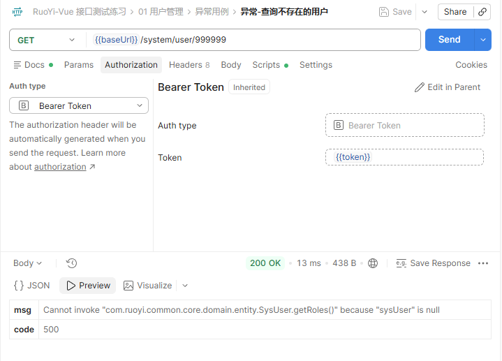

【缺陷标题】查询不存在的用户时，接口返回 Java 异常信息

【所属模块】系统管理 / 用户管理
【接口】GET /system/user/{userId}
【严重程度】中

【复现步骤】
1. 登录获取 token

   POST http://localhost:8080/login
   Body: {"username":"admin","password":"admin123","code":"","uuid":""}

2. 请求一个不存在的用户：

```bash
curl --location --request GET 'http://localhost:8080/system/user/999999' \
     --header 'Authorization: Bearer <登录后获取的token>'
```

【预期结果】
返回一句能看懂的提示，比如 {"code":500,"msg":"用户不存在"}，不要暴露后端内部信息。

参考：同一个系统的 GET /system/config/configKey/不存在的key 返回 {"msg":"","code":200}，
没有泄露任何内部实现，说明这个接口本来可以做得更好。

【实际结果】
HTTP 200，业务 code=500：

{"msg":"Cannot invoke \"com.ruoyi.common.core.domain.entity.SysUser.getRoles()\" because \"sysUser\" is null","code":500}

响应里出现了后端的包名、类名、方法名。

补充：
- 传 userId=-1 也是同样的报错，说明不是 999999 这个值特殊
- 用 ry 账号查数据范围外的用户（userId=1）时，返回的是「没有权限访问用户数据！」，
  这是正常的可读提示，不在本缺陷范围内

【影响】
1. 响应里暴露了后端的包名、类名、方法名，可以被用来收集攻击信息
2. 提示信息不可读，前端只能统一提示「系统异常」，分不清是用户不存在还是服务出错

【建议】
SysUserController.getInfo() 里，selectUserById 之后先判空再取属性：

```java
SysUser sysUser = userService.selectUserById(userId);
if (sysUser == null) {
    return error("用户不存在");
}
```

【附件】
