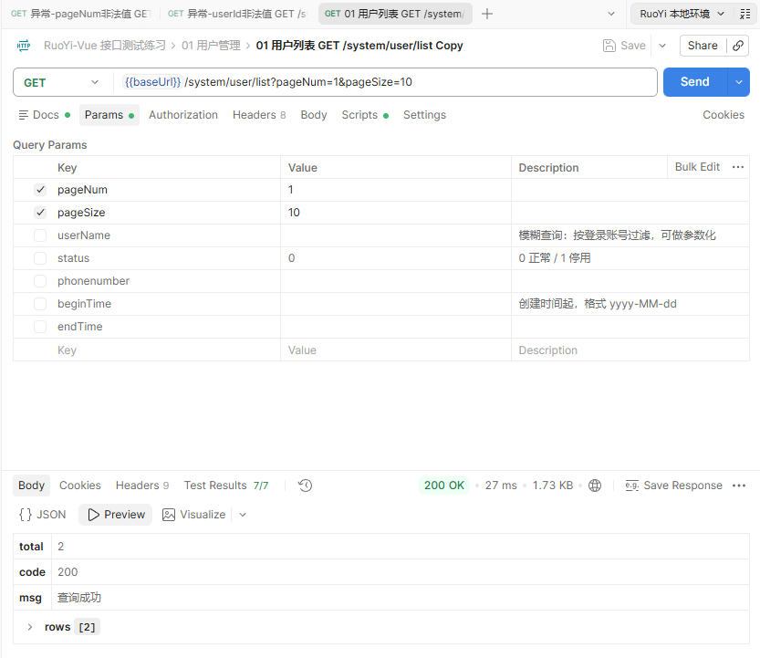
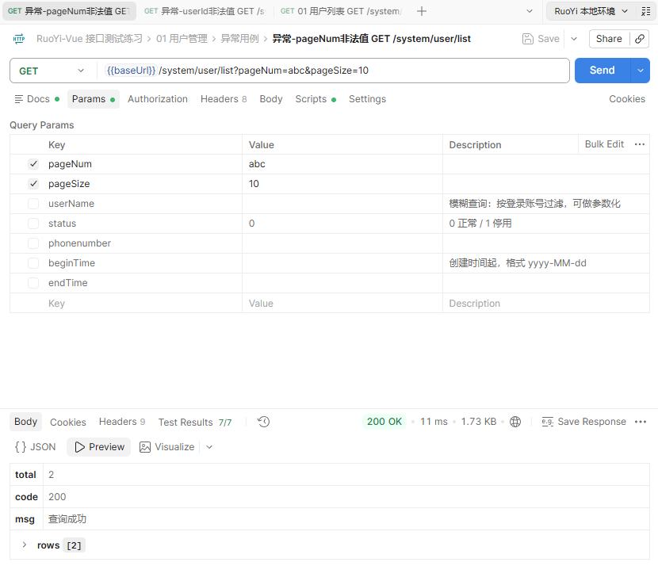
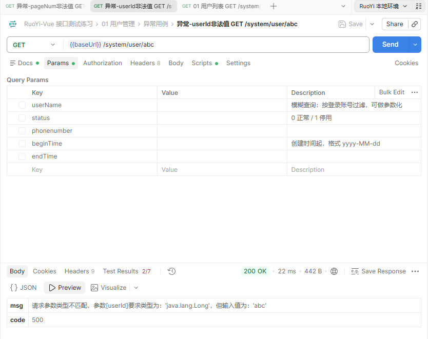

【缺陷标题】分页参数 pageNum 传非法值被静默当成默认值，和同一个模块的 userId 报错方式不一致

【所属模块】系统管理 / 用户管理
【接口】GET /system/user/list
【严重程度】低

【复现步骤】
1. 登录获取 token

   POST http://localhost:8080/login
   Body: {"username":"admin","password":"admin123","code":"","uuid":""}

2. pageNum 传非数字 abc：

```bash
curl --location --request GET 'http://localhost:8080/system/user/list?pageNum=abc&pageSize=10' \
     --header 'Authorization: Bearer <登录后获取的token>'
```

3. 对照：同一个模块的 userId 传非数字：

```bash
curl --location --request GET 'http://localhost:8080/system/user/abc' \
     --header 'Authorization: Bearer <登录后获取的token>'
```

【预期结果】
pageNum / pageSize 传非数字时应该给出明确的参数错误提示，和 userId 保持一致。

参考：userId 传 abc 时返回了明确提示
{"code":500,"msg":"请求参数类型不匹配，参数[userId]要求类型为：'java.lang.Long'，但输入值为：'abc'"}，
说明分页参数这里是漏了校验。

【实际结果】

基准（pageNum=1&pageSize=10）：正常返回 total=2。



pageNum 传 abc：**HTTP 200，业务 code=200，正常返回用户列表**，
静默按 pageNum=1 处理，没有任何提示。



对照 —— 同一个模块的 userId 传 abc：**业务 code=500，给出明确提示。**



| 请求 | 业务 code | 返回 |
| --- | --- | --- |
| pageNum=abc | 200 | 正常返回用户列表，静默按 pageNum=1 处理，没有任何提示 |
| /system/user/abc | 500 | 请求参数类型不匹配，参数[userId]要求类型为：'java.lang.Long'，但输入值为：'abc' |

其他边界值：

| 参数 | 业务 code | 返回 |
| --- | --- | --- |
| pageSize=abc | 200 | 静默按 pageSize=10 处理 |
| pageNum=0 / -1 | 200 | 都按第一页处理 |
| pageSize=0 / -1 | 200 | 返回空列表（rows=0），没有提示 |
| pageSize=100000 | 200 | 没有上限，全部返回 |

影响范围：pageNum=abc 在 role、dict、config、post、operlog、job 六个列表接口全部返回 200，
说明是所有分页列表接口的共性问题，不是单个接口的问题。

【影响】
1. 参数写错时不报错，用户看到的还是第一页，问题很难发现
2. 同一个模块两套处理方式，前端没法统一处理错误
3. pageSize 没有上限，数据量大时可能影响性能

【建议】
在 TableSupport.getPageDomain() 里对 pageNum / pageSize 做校验，非法值返回明确提示；
另外给 pageSize 加一个上限（比如 500）。

【附件】
1. 证据/D7-03-基准正常返回.png
2. 证据/D7-01-pageNum传abc被静默降级.png
3. 证据/D7-02-userId传abc明确报错-对照.png