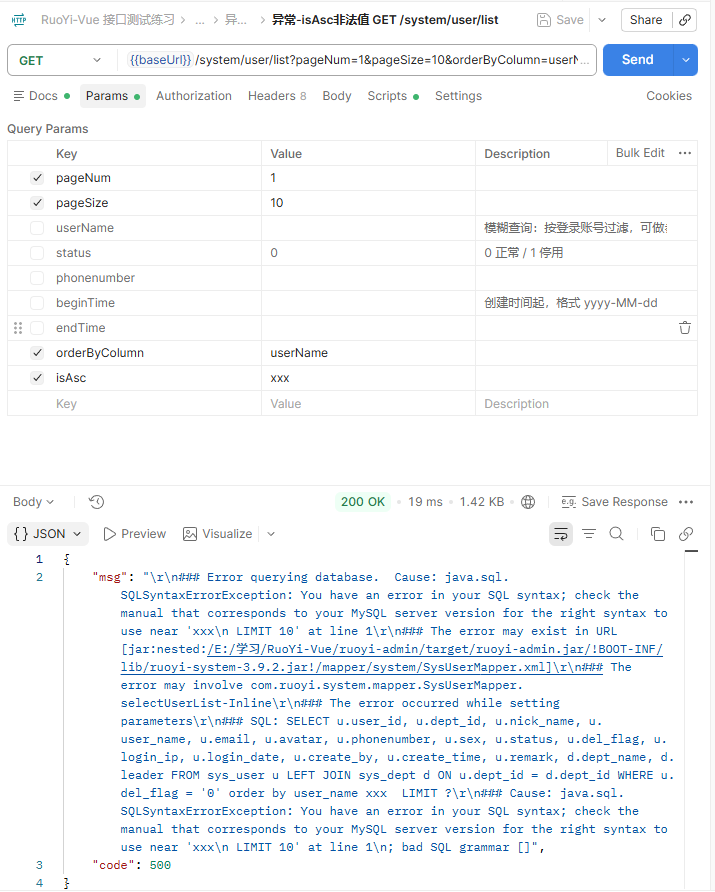
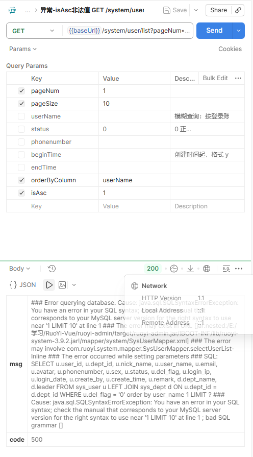
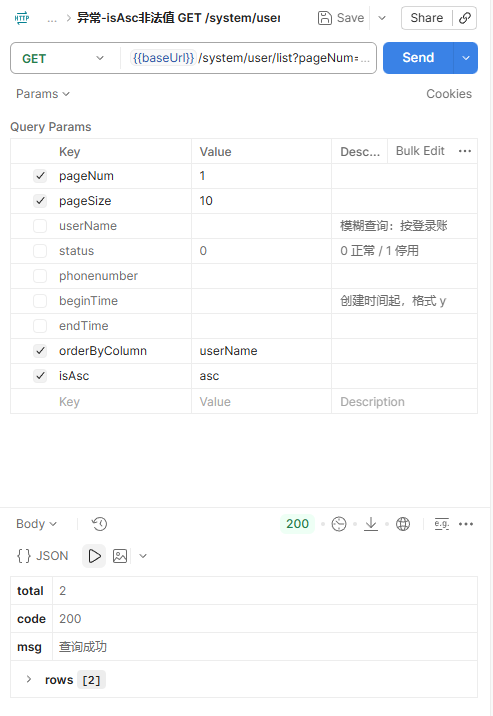
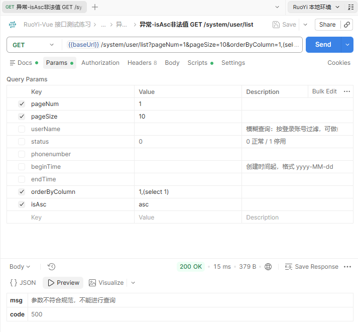

【缺陷标题】排序参数 isAsc 传非法值，接口把 SQL 语句和服务器路径返回给了客户端

【所属模块】系统管理 / 用户管理
【接口】GET /system/user/list
【严重程度】高

【复现步骤】
1. 登录获取 token

   POST http://localhost:8080/login
   Body: {"username":"admin","password":"admin123","code":"","uuid":""}

2. 请求用户列表，isAsc 传非法值 xxx：

```bash
curl --location --request GET 'http://localhost:8080/system/user/list?pageNum=1&pageSize=10&orderByColumn=userName&isAsc=xxx' \
     --header 'Authorization: Bearer <登录后获取的token>'
```

3. 观察响应体（约 1129 字符 / 1.4 KB）

【预期结果】
isAsc 只应该接受 asc / desc，传其他值应该返回能看懂的提示，比如：
{"code":500,"msg":"排序方向不合法，仅支持 asc 或 desc"}

参考：同一个接口的排序字段参数 orderByColumn 是有校验的 ——
传 1,(select 1) 会返回「参数不符合规范，不能进行查询」，说明 isAsc 是漏了校验。

【实际结果】
HTTP 200，业务 code=500，响应体把下面这些直接返回给了客户端：

1. 完整 SQL 语句
   SELECT u.user_id, u.dept_id, ... FROM sys_user u LEFT JOIN sys_dept d ON ...
   WHERE u.del_flag = '0' order by user_name xxx LIMIT ?
2. 表名、字段名、表关联关系、软删除条件（del_flag = '0'）
3. 服务器本地路径：E:/学习/RuoYi-Vue/ruoyi-admin/target/ruoyi-admin.jar
4. Jar 包名和内部类名：ruoyi-system-3.9.2.jar、com.ruoyi.system.mapper.SysUserMapper
5. Mapper 文件路径：mapper/system/SysUserMapper.xml
6. 数据库类型：java.sql.SQLSyntaxErrorException / MySQL



isAsc 传数字 1，同样触发泄露：



对照 —— isAsc=asc 时正常返回：



对照 —— orderByColumn 的注入被正确拦截（说明这里本该校验）：



边界值测试：

| isAsc 取值 | 业务 code | 结果 |
| --- | --- | --- |
| asc / desc / ASC / asc,user_id / 空值 | 200 | 正常返回 |
| 1 / xxx / nonexistent | 500 | 报错，并泄露上面那些信息 |

影响范围：同样的 isAsc=xxx 在这些接口全部复现（都是 code=500 并且泄露 SQL）：
/system/role/list、/system/config/list、/system/post/list、/system/dict/type/list、
/monitor/operlog/list、/monitor/job/list
（/system/dept/list 返回树结构、不走分页，不受影响）

补充说明：字符白名单挡住了 = ( ; 这些符号，所以不能利用它窃取数据，
不属于 SQL 注入漏洞；但信息泄露是成立的。

【影响】
1. 泄露数据库结构、SQL 语句和服务器路径，可以被用来做后续攻击的信息收集
2. 影响所有带排序功能的分页列表接口，属于框架级问题
3. 前端会把 1129 个字符的异常文本直接展示给用户

【建议】
在 PageDomain.getOrderBy() 里对 isAsc 做白名单校验，只允许 asc / desc，
其他值按 asc 处理，或者返回业务异常。

【附件】
1. 证据/D9-01-isAsc传xxx泄露SQL与服务器路径.png
2. 证据/D9-02-isAsc传1同样触发泄露.png
3. 证据/D9-03-orderByColumn注入被拦截-对照.png
4. 证据/D9-04-isAsc传asc正常返回-对照.png